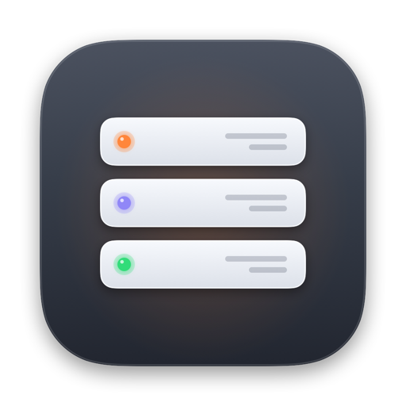

# XamppLocal — Native Apple Silicon (`arm64`) Local Web Stack

<p align="left">
  
</p>

[](LICENSE)
[](#quick-start)

A fast, lightweight, native macOS `arm64` replacement for legacy Intel XAMPP—built for WordPress, Laravel, and college PHP projects with **zero Rosetta 2**, **zero existing package upgrades**, **Laragon-style website folder switching**, **on-demand selectable database engines**, and a **zero-polling native Swift control app**.

---

## Features

* **100% Native `arm64` Execution:** Built-in macOS Apache (`/usr/sbin/httpd`, `mpm_event` + `mod_proxy_fcgi`), PHP-FPM (`pm = ondemand`, OPcache enabled), and MySQL 8.4 LTS.
* **Zero Mac Package Drift:** Pins your existing Homebrew PHP (`brew pin php`) and uses an official precompiled MySQL 8.4 `arm64` archive plus built-in Apache so shared libraries (`lz4`, `pcre2`, `apr-util`, `abseil`, `protobuf`) stay untouched.
* **Laragon-Style Website Folder Picker:** Switch Apache's active `DocumentRoot` to **any folder anywhere on your Mac** via **Switch Website Folder...** (`⌘L`) in the menu bar / Control Window (with automatic Laravel `public/` detection and recent folder history) or `xamppctl webroot /path/to/site`.
* **Selectable Database Engines (MySQL Default):**
  * **`mysql`** (*Default*): MySQL 8.4 LTS on `127.0.0.1:3306` + Unix socket.
  * **`sqlite`** (*Built-in*): Zero-daemon, `0 MB` DB RAM via PHP `pdo_sqlite`.
  * **`mariadb`** & **`postgresql`** (*On-Demand*): Stay undownloaded (`0` disk space) until explicitly installed and selected via `xamppctl db install <engine> --use`.
* **Hardened Local Security:** Isolated phpMyAdmin origin on `http://127.0.0.1:8081/` (separate from project sites on `:8080`), strict `127.0.0.1`-only binding, `0700`/`0600` runtime & log permissions, case-insensitive APFS protection against `.env`/`.git`/`.sql`/`.swp` leaks, `SymLinksIfOwnerMatch`, and DNS-rebinding guards.
* **Long-Project Friendly:** Quitting `XamppControl.app` keeps servers running in the background; Apache `Timeout 600` / `ProxyTimeout 600`, PHP `max_execution_time = 600`, and `request_terminate_timeout = 0` prevent premature timeouts during large imports or migrations.

---

## Quick Start

### Option 1: DMG Installer (macOS Apple Silicon)
1. Download **`XamppLocal.dmg`** from [GitHub Releases](https://github.com/mrutyunjay11/XamppLocal/releases/latest) and open it.
2. Drag **`XamppControl.app`** into **`Applications`**.
3. On a fresh Mac, initialize PHP/MySQL 8.4/phpMyAdmin once:
   ```bash
   /Applications/XamppControl.app/Contents/Resources/stack/scripts/setup.sh
   ```
4. Launch **`XamppControl`** from Applications or Spotlight.

### Option 2: From Source (Git Clone)
```bash
git clone https://github.com/mrutyunjay11/XamppLocal.git
cd XamppLocal
chmod +x scripts/setup.sh bin/xamppctl app/build.sh
./scripts/setup.sh
open app/XamppControl.app
```

---

## CLI Reference (`xamppctl`)

| Command | Purpose |
| :--- | :--- |
| `xamppctl start [all\|apache\|php\|db]` | Pre-flight checks + ordered start (`php-fpm` → `httpd` → DB) |
| `xamppctl stop [all\|apache\|php\|db]` | Clean shutdown (`httpd graceful-stop` → `php-fpm` → `20s` InnoDB flush) |
| `xamppctl restart [target]` | Clean ordered restart |
| `xamppctl status [--json] [--memory]` | Live status + optional `/usr/bin/footprint` RAM measurement |
| `xamppctl webroot [path\|--list\|--reset]` | Switch Apache `DocumentRoot` to any folder (Laragon-style) |
| `xamppctl vhost <add\|remove\|list\|dns>` | Manage per-project `*.test` virtual hosts |
| `xamppctl db list` | Show engine status (`ACTIVE`, `INSTALLED`, `NOT_DOWNLOADED`) |
| `xamppctl db install <mariadb\|postgresql> [--dry-run] [--use]` | Preview dependencies and install optional DB engine on demand |
| `xamppctl db use <mysql\|mariadb\|postgresql\|sqlite>` | Switch active database engine (refuses undownloaded engines) |
| `xamppctl db profile <default\|eco\|import>` | Switch DB buffer pool profile (`64M` / `32M` / `256M`) |
| `xamppctl db import <file.sql> [db] [--convert-collation]` | Stream SQL import with `utf8mb4_0900_*` MariaDB guard |
| `xamppctl port80 <enable\|disable\|status>` | Optional `pf` redirect (`127.0.0.1:80 → 8080`) |
| `xamppctl logs [all\|apache\|php\|db] [-f]` | Tail service logs |
| `xamppctl doctor` | Run 13 health, permission, arch, and package-drift checks |

---

## Architecture & Directory Layout

* **Repository (`XamppLocal/`):** Config templates (`config/`), CLI controller (`bin/xamppctl`), native Swift GUI (`app/`), dashboard template (`htdocs-template/`), and setup/DMG/benchmark scripts (`scripts/`).
* **Runtime & Data (`~/Library/Application Support/XamppLocal/`, mode `0700`):** Databases (`data/`), Unix sockets & PIDs (`run/`), rotated logs (`logs/`, `10M × 3`), and downloaded engines (`engines/`). Kept outside `~/Desktop` and iCloud sync.

---

## Troubleshooting & Common Fixes

* **HTTP `403 Forbidden` when serving a folder in `~/Desktop`, `~/Documents`, or `~/Downloads`:**  
  macOS platform security (TCC) blocks Apple's `/usr/sbin/httpd` from reading Desktop/Documents/Downloads by default. Put or symlink project folders in `~/Sites`, `~/Projects`, or `~/Developer` (or configure Homebrew `httpd_bin` in `config/stack.json`).
* **Port already in use (`8080`, `8081`, `3306`, `5432`):**  
  `xamppctl start` prints the conflicting PID and process name via `lsof`. Stop the old XAMPP/Homebrew service or update `http_port` / `pma_port` in `config/stack.json`.
* **MySQL `utf8mb4_0900_ai_ci` dump fails on MariaDB:**  
  Run `xamppctl db use mysql` (recommended), or stream-convert with `xamppctl db import dump.sql mydb --convert-collation`.
* **Dashboard works even when DB is stopped:**  
  `http://127.0.0.1:8080/` shows live DB status (`Connected` / `Offline`); phpMyAdmin runs isolated on `http://127.0.0.1:8081/` whenever `mysql` or `mariadb` is active.

---

## Cross-Platform & Linux Support (Help Wanted / Roadmap)

`XamppLocal` is currently built specifically for **Apple Silicon macOS (`arm64`, macOS 14+)**. Contributions to add **Linux support** and fix edge-case issues are very welcome!

Areas needed for Linux compatibility (`Ubuntu`, `Debian`, `Fedora`, `Arch`):
1. **Binary & Package Paths (`bin/xamppctl`):** Map `httpd_bin` (`/usr/sbin/apache2` / `/usr/sbin/httpd`), `php-fpm`, `mysql`/`mariadb`/`postgresql` paths, and `apt`/`dnf`/`pacman` alongside Homebrew.
2. **Runtime & Memory Measurement:** Use `$XDG_DATA_HOME/XamppLocal` (`~/.local/share/XamppLocal`) instead of `~/Library/Application Support/XamppLocal`, read `/proc/<pid>/smaps_rollup` (`Pss`) instead of macOS `/usr/bin/footprint`, and detect timezone via `/etc/timezone` or `/etc/localtime`.
3. **Desktop UI:** Add an optional Linux tray/window wrapper (GTK / AppIndicator / Qt) or CLI-first mode (`bin/xamppctl` already runs cleanly on Python 3 with zero third-party packages!).

### Reporting Issues or Contributing Fixes
Before opening an issue or PR, please attach the output of:
```bash
./bin/xamppctl doctor
./bin/xamppctl status --json
```
and include your macOS (or Linux distro) version, PHP version, and active DB engine (`mysql` / `mariadb` / `postgresql` / `sqlite`).

---

## License & Third-Party Notices

This project is licensed under the **MIT License** — see [LICENSE](LICENSE).

Third-party tools orchestrated by XamppLocal retain their own respective licenses (Apache HTTP Server: Apache-2.0; PHP: PHP License 3.01; MySQL Community / MariaDB / phpMyAdmin: GPL-2.0; PostgreSQL: PostgreSQL License).
